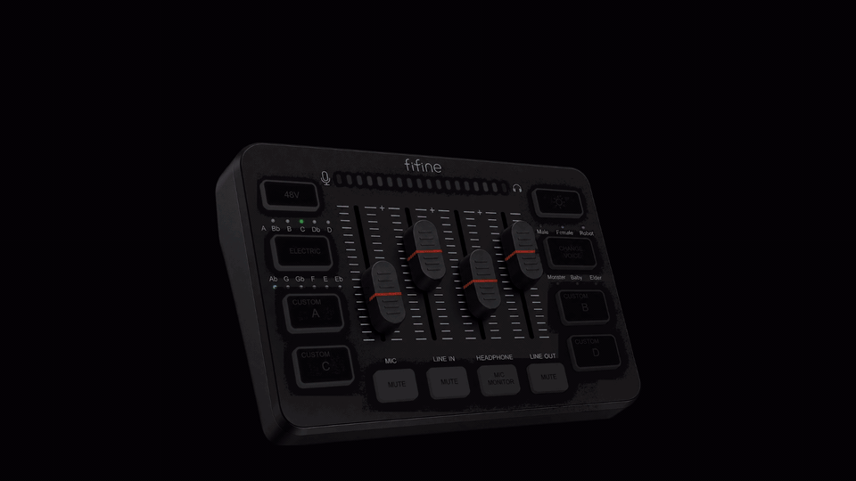
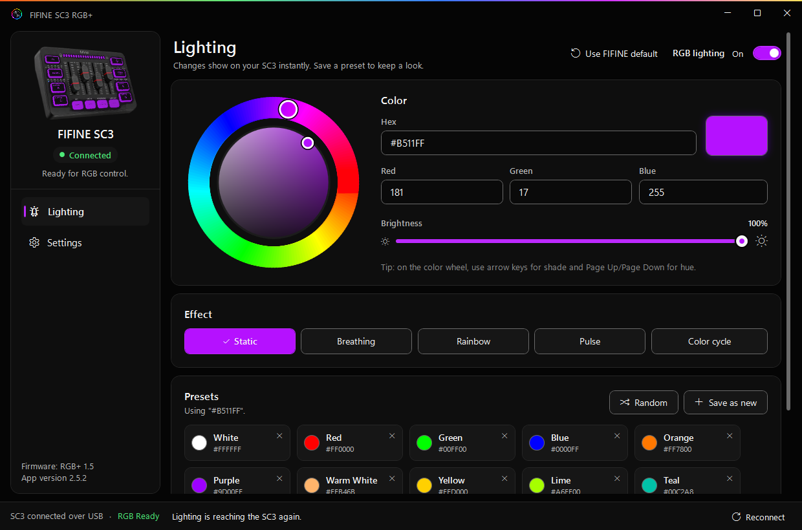
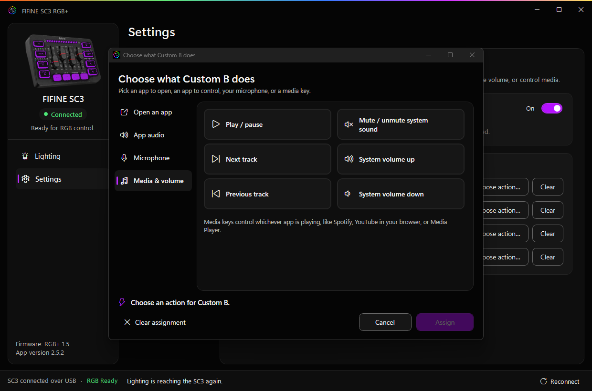
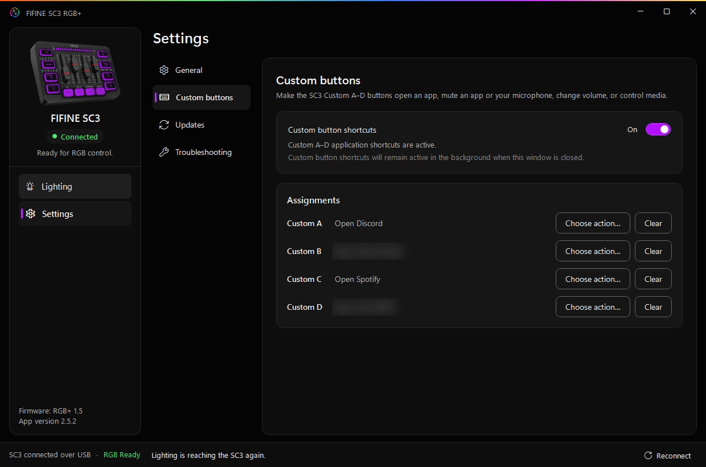

# FIFINE SC3 RGB+

FIFINE SC3 RGB+ is a Windows application that adds customizable RGB lighting
control and Custom Button Shortcuts to the FIFINE AmpliGame SC3 mixer.



*25-second tour. [Watch it with sound (MP4)](docs/brag.mp4).*



## Features

- Custom RGB colors, color wheel, hex/RGB entry, and brightness control, applied to the mixer live
- RGB lighting on/off switch, and a one-click return to FIFINE's default lighting
- Presets you can save, rename, and delete with Undo, plus 14 starter colors and a Random color button
- Static, Breathing, Rainbow, Pulse, and Color Cycle effects
- Adjustable 1–100% speed for animated effects, remembered per effect
- Custom A/B/C/D button actions, chosen from a picker instead of a file dialog:
  - **Open an app** from your Start menu list (including Store apps), or any `.exe`/`.lnk`
  - **App audio:** mute/unmute or volume up/down for one app, such as Discord or Spotify
  - **Microphone** mute/unmute
  - **Media & volume:** play/pause, next, previous, system volume and mute
- Background shortcut engine with Windows system tray controls
- Accessible: full keyboard use with visible focus, screen-reader names and announcements, Windows High Contrast support, and text that stays readable on any chosen color
- Integrated Settings for application updates, mixer firmware updates, and troubleshooting
- Automatic application updates through GitHub Releases
- Safe Restore Original Firmware and SC3 Recovery Mode support
- Automatic SC3 detection, reconnect handling, and Start with Windows

## What's new in this update

**Works on every PC, not just one.** Earlier builds checked a USB device ID that Windows
generates separately for each PC and USB port, so every SC3 except the original
development machine was rejected as *"Unsupported or unvalidated SC3 revision"*.
Detection now relies on the mixer's real identity: vendor/product ID, interface,
descriptor strings, report layout and the firmware version reply. It was verified on
a second PC and port, and the RGB+ Firmware 1.5 install was confirmed end to end.

**Buttons say what they do.** Colors always applied live, but the old *Apply* button
only saved, and *Stop* switched to FIFINE's lighting. The Lighting page now has a
labelled **RGB lighting** switch and a banner when lighting is off. *Save changes*
appears only when a preset is edited, and *Save as new* creates a preset and lets you
name it right away. Deleting a preset can be undone.

**Custom buttons do real actions.** Instead of browsing for an `.exe`, pick from your
apps, or make a button mute Discord, step Spotify's volume, mute your mic or
skip a track.

| Custom button picker | Custom buttons |
|---|---|
|  |  |

**Built for everyone.**
- Every control has a visible keyboard focus ring and a screen-reader name, role and state.
- Status changes are announced aloud.
- The color wheel accepts a typed hex code from assistive tech, with Page Up/Down for hue.
- Windows High Contrast is supported.
- Text keeps WCAG contrast (4.5:1) on any chosen color, which fixes white-on-white with light colors.
- The window resizes, snaps, and fits 1366×768 screens at 125% scaling.

**Under the hood:** 5 new firmware-detection regression tests and 9 new Custom-button
action tests (41 checks in total). The fader check also showed that the SC3's faders
and knobs work inside the mixer and send no data to the PC, so per-app fader mapping
isn't possible with the current firmware.

## Supported hardware

FIFINE AmpliGame SC3. The included RGB+ firmware modification is intended only
for the supported SC3 device profile.

## Installation

1. Download `FIFINE-SC3-RGB-Plus-2.5.2-Setup.exe` from [Releases](../../releases).
2. Install FIFINE SC3 RGB+.
3. Connect the FIFINE SC3.
4. If RGB+ firmware is not installed, use the in-app firmware setup action. New Stock V22 devices install the current RGB+ Firmware 1.5 directly.

Custom Button Shortcuts require **RGB+ Firmware 1.5**. If you already use RGB+
Firmware 1.4, open **Settings → Updates** and choose **Update Firmware**. The
application update and mixer firmware update are separate operations; mixer
firmware is never flashed automatically.

The current Firmware 1.5 sends Custom A–D events through the SC3 interrupt
interface, so shortcuts remain responsive without continuous firmware polling.

Normal users do not need to download MVA files or use a vendor updater manually.
Do not disconnect the SC3 while firmware setup, update, or restoration is in progress.

## Firmware and recovery

**Settings → Updates** shows both the application version and connected mixer
firmware version. RGB+ Firmware 1.4 can update directly to Firmware 1.5, and
supported Stock V22 can install Firmware 1.5 directly without an intermediate
Firmware 1.4 installation.

**Settings → Troubleshooting → Restore Original Firmware** restores validated
Stock V22 firmware, removes RGB+ support, and returns the app to **RGB setup
required**. If the SC3 is already in Recovery Mode, the app detects it and
offers the same safe restore path.

Firmware redistribution scope is documented in
[FIRMWARE_PERMISSION.md](FIRMWARE_PERMISSION.md).

## Build

Requirements: Windows, .NET 8 SDK, and Inno Setup 6.

```powershell
powershell -ExecutionPolicy Bypass -File .\scripts\build-release.ps1
```

The script validates the production firmware package, builds the Windows app and
native updater, creates the installer, and generates the update manifest and
SHA-256 checksum.

`firmware/recovery/` is git-ignored, so the build needs the validated
`SC3_V22_recovery.MVA` placed there before it runs. Its expected SHA-256 is in
`scripts/build-release.ps1`.

Run the test suites with:

```powershell
dotnet run --project Updater\SC3FirmwareTool.Tests -c Release
dotnet run --project Updater\CustomButtons.Tests -c Release
dotnet run --project Updater\ApplicationUpdate.Tests -c Release
```

## License

Project source code is available under the [MIT License](LICENSE). The bundled
modified SC3 firmware is distributed under the documented permission and is not
claimed as MIT-licensed project source.

## Unofficial community project

FIFINE SC3 RGB+ is an unofficial community project and is not affiliated with
or endorsed by FIFINE. FIFINE and AmpliGame are trademarks of their respective
owner.
